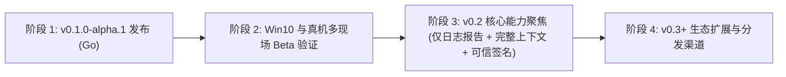

# GameCrash Kit 项目阶段总结与后续规划（v0.1.0-alpha.1 → v0.3+）

> 文档更新时间：2026-11-26 · 当前代码基线：`main` `@fba6384` · 目标版本：`v0.1.0-alpha.1`

---

## 一、项目概述与核心设计原则

**GameCrash Kit（游戏闪退急诊室）** 是一款面向 PC 玩家的免费、开源、纯本地只读游戏崩溃事后取证与诊断工具，用于在游戏闪退后 30 秒内完成事后证据收集、版本化规则归因，并输出可直接发往玩家社区或 AI 排查的零隐私脱敏急诊单。

本项目坚持五项安全与克制设计边界：

1. **纯本地只读**：仅在用户主动触发后读取本地 Windows Event Log XML、只读环境快照与用户手选引擎日志，严禁篡改游戏目录、系统注册表、驱动或游戏运行文件，分享保存同样禁止覆盖当前源日志。
2. **零提权（`asInvoker`）**：不弹出 UAC 提权框，不安装内核驱动，不驻留后台常驻服务。
3. **零联网**：安装包、主程序、规则引擎与目录探测全部离线运行（目录探测前即拦截 UNC/非本地固定盘及重解析点），不发起遥测或外连请求。
4. **反作弊零接触**：不注入任何游戏进程、不读写进程内存、不附加调试器，仅作事后离线分析。
5. **两层严格白名单脱敏**：默认共享仅导出白名单字段与粗粒度安全安装来源类别（绝不导出私人目录路径或原文自由文本）；可选日志信号摘要仅输出固定结构化标记模板；PNG 急诊单独立维持浅底高可读性样式。

---

## 二、已完成里程碑回顾（M0–M4 及审阅整改）

| 里程碑 | 核心提交 | 关键交付与里程碑能力 |
| :--- | :--- | :--- |
| **立项基线** | `9181a18` | 确认 `GameCrash Kit v0.1` 架构边界、可信刻度模型与分阶段验收标准 |
| **M0 基建与契约** | `cd85737` | `.NET 10` 解耦方案（`Core` / `Windows` / `App`）、双许可（MIT / Apache-2.0）、证据矩阵、XML 测试夹具、`TreatWarningsAsErrors=true` 严格编译 |
| **M1 核心关联与规则** | `6c320b5` | Windows Event Log（1000 / 1001 / 1002 / KP41）关联引擎、`PathClassifier`、7 项中性环境探针、10 条版本化纯 C# 规则 |
| **M2 安全日志与单窗 UI** | `bc07847` | 安全本地文件沙盒读取器（拒 UNC/设备路径/重解析点、大文件 2 MiB 尾部安全截断、UTF-8 校验）与 WPF 单窗诊断工作台 |
| **M3 导出与视觉打磨** | `7962d23` ~ `718ea6e` | 白名单 `ShareReportProjector`、Markdown 与独立离屏 `900px / 96 DPI` 浅底 PNG 导出；极夜深空赛博主题（`#0B0E14` / `#6366F1` / `#22D3EE`）、响应式工具栏及 `app.ico` 图标 |
| **M4 发布、门禁与沙盒** | `e5df744` ~ `0f2f537` | 源码静默外连/零写/反作弊零接触审计测试、CI/Release Workflows、绿色便携发包防泄漏门禁及 100% 无人值守离线 Windows Sandbox 验收台 |
| **P0/P1 深度对抗评审整改** | `fba6384` | 完成全部 5 项 P0 与核心 P1 修复（见下文第三节），并通过纯净 `git archive` 检出测试与二次离线沙盒 10/10 复验 |

---

## 三、P0 / P1 对抗评审关键整改记录（`fba6384`）

1. **干净 Git 检出门禁（P0-1）**：`.gitignore` 新增 `!tests/Fixtures/EngineLogs/unity-player-gpu-lost.log` 例外并将该合成夹具纳入版本控制，确保纯净克隆可直接通过全部构建与单测。
2. **单源版本一致性（P0-2）**：统一 [Directory.Build.props](../Directory.Build.props) 为 `0.1.0-alpha.1`，新增 [AppVersionInfo.cs](../src/GameCrashKit.Core/AppVersionInfo.cs) 从程序集元数据读取版本号；`Publish-Portable.ps1` 构建与发布均注入 `-p:Version` 并校验 `ProductVersion`。
3. **跨事故日志串用隔离（P0-3）**：`MainViewModel` 改为按扫描会话与 `IncidentId` 字典独立绑定引擎日志，切换候选事故 A → B 时立即重置日志关联与诊断结论，绝不交叉污染。
4. **两层脱敏与分享防护（P0-4 + P1）**：
   - 共享报告将私有目录后缀改为安全分类标签“安装来源”（`PathClassifier.BuildShareSafeInstallSource`），`HideAppName` 同时覆盖同名故障模块（`<APP_MODULE>`）、结论与摘要；
   - `PrivacyScrubber` 补齐 2 字中文用户名、1 字主机上下文、SteamID3/Legacy ID、带引号凭据及可选时钟 `<TIME>` 擦除，标识符统一开启 IPv4/IPv6 擦除；
   - 可选日志信号摘要仅输出固定结构化模板（不再导出最后 5 行原文或自由 `ErrorMessage`）；
   - 复制 Markdown 附加 Windows 云剪贴板与历史排除标记（`CanUploadToCloudClipboard=0` / `CanIncludeInClipboardHistory=0`），导出保存禁止覆盖当前取证源日志并提醒 OneDrive 同步路径。
5. **纯本地无远程目录探测（P0-5 + P1）**：`OneDriveDocsProbe` 与有界/可取消的 `EngineLogDiscovery` 改用 `SpecialFolderOption.DoNotVerify` 且先验固定盘局部性及祖先重解析点；新增 UTF-16 LE/BE BOM 支持与 `.runtime-xml` 选择器过滤及截断拒绝；主窗/预览窗适配工作区尺寸与 `MinHeight`（`480` / `460`）。
6. **关联器与规则克制性加固（P1）**：`IncidentCorrelator` 改为两阶段 WER 匹配（优先全批唯一 `ReportId` Direct 匹配，再跑弱匹配并禁止跨冲突 ID 关联）且聚合组保留已有 WER 证据；`ThirdPartyModuleHintRule` 要求代理 DLL 路径同目录命中；`EngineOomRule` 对孤立 `0xe0000008` 降级为有限线索且不建议修改页面文件；主结论超 3 条时保留折叠补充线索与歧义限制提示。

---

## 四、已验证的质量、性能与实测结果

### 4.1 宿主机与纯净 `git archive` 检出回归测试
- **Release 构建**（`Version=0.1.0-alpha.1`）：**0 警告、0 错误**。
- **纯净 `git archive` 快照测试**：在零未跟踪文件的 `HEAD` 导出目录独立执行 `dotnet test GameCrashKit.sln -c Release`，**82 / 82 全部通过**（`Core.Tests` 46 + `Windows.Tests` 28 + `App.Tests` 8，0 失败 0 跳过）。
- **宿主机 M4 发布门禁**（`Verify-ReleaseGate.ps1`）：清单（`asInvoker`）、包完整性（0 测试工具泄漏）、只读哈希不变性、20 次真实扫描基准全部 `PASS`（`Min=27.3ms | P50=30.5ms | P95=40.9ms | Max=66.4ms`）。

### 4.2 最终离线 Windows Sandbox 无人值守验收（`2026-11-26 21:26:25 +08:00`）
在 **完全断网（`Networking=Disable`）、无 `.NET 10` 预装、非提权 `WDAGUtilityAccount`** 的 Windows 11 24H2（Build `26100.9457`）沙盒中，无人值守套件执行 **10 / 10 项全部 `PASS`**：

| 验收项 | 状态 | 实测指标 |
| :--- | :--- | :--- |
| `Check1a.OfflineNoNet10Environment` | **PASS** | `SandboxUser=True`, `Offline=True`（DNS 阻断）, `HostNet10Preinstalled=False` |
| `Check1b.CleanPortableArtifact` | **PASS** | `ExeExists=True`, `ProductVersion=0.1.0-alpha.1+fba638...`, `LeakedTestBinaries=[]` |
| `Check2.RealCrashCapture` | **PASS** | 实测捕获真实 `SyntheticCrashTool.exe` `Event 1000`（`0xc0000005`） |
| `Check2b.SampleLogReadOnly` | **PASS** | Unity 日志解析成功（`GpuLost=True`），SHA-256 与修改时间 100% 不变 |
| `Check3b.ReportVersionConsistency` | **PASS** | `ReportAppVersion=0.1.0-alpha.1 == Expected=0.1.0-alpha.1` |
| `Check3.RuleEngineCoverage` | **PASS** | 关联日志触发 `[ENGINE-GPU-LOST@1, EXCEPTION-AV@1, APP-CRASH@1]` |
| `Check4a.MarkdownPrivacyScrub` | **PASS** | 导出 3568 字节 Markdown（含安全安装来源与固定信号摘要），`Leaks=[]` |
| `Check4b.PngEmergencyCard` | **PASS** | 导出 `900×1312` px、`96.0×96.0 DPI`、`150762` 字节 PNG，浅底画布校验通过 |
| `Check5.LatencyBenchmark20Runs` | **PASS** | 沙盒连续 20 次扫描：`Min=28.2ms` / `Avg=31.6ms` / `P95=35.8ms` / `Max=38.6ms` |
| `Check6.PortableGuiSmokeLaunch` | **PASS** | 免 UAC 启动绿色便携版 GUI（主窗口句柄就绪耗时 `4ms`） |

### 4.3 最终 `v0.1.0-alpha.1` 便携发行包校验信息
- 便携归档包：`publish/GameCrashKit-v0.1.0-alpha.1-win-x64.zip`（`62.45 MB`）
- SHA-256：`40aedcb8a443e0714e06b7ea6c4fab1985a2bf169d852b8800bceeadba134e94`

---

## 五、当前边界与后续计划（基于对抗评审重排优先级）

### 阶段 1：`v0.1.0-alpha.1` 发版就绪（立即执行）
- 绑定 GitHub 远程仓库，推送 `main` 并打 Tag `v0.1.0-alpha.1`，由 `.github/workflows/release.yml` 自动产出便携 ZIP 与 `SHA256SUMS.txt`；随发布页附上本轮核验的 SHA-256 与未签名运行说明。

### 阶段 2：真机多环境实测（短期 / 1–2 周）
- 在 **Windows 10 22H2**、英文/繁体系统、125%–200% DPI 缩放及浏览器下载 SmartScreen 流程下以普通标准账户实机验证同一发行包，并采集真实商业游戏 1000/1001/1002 XML 与 UE5/Unity 日志扩充夹具。

### 阶段 3：`v0.2` 聚焦最影响留存的 3 件实事（中期）
1. **无 Windows 锚点“仅手选日志”独立报告**：让仅有游戏自带 CrashContext/Player.log 的玩家也能拿到明确归属状态（区分 fatal/ensure/未知）与结构化证据卡片，不再退回空泛 `UNKNOWN`。
2. **让单次分享一次回答社区前三大问题**：明确写出扫描时间窗、通道截断/权限受限说明及可对照验证的一步操作与稳定规则标签，减少回帖反复追问。
3. **优先解决便携版首次运行可信度**：推进开源可验证 Authenticode 代码签名并打通浏览器下载至标准账户无阻启动体验；**暂缓**扩大 `AppData` 无预算搜索、按驱动事件编号泛化归因、专用 AI Prompt 模板与完整双语 UI。

### 阶段 4：`v0.3+` 生态扩展（中长期）
- 在验证完驱动后台事件负例后再考虑 `Display 4101` / `nvlddmkm` 背景关联增强、多语言资源与 Scoop/Winget 包管理器接入。
