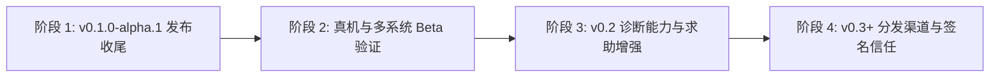

# GameCrash Kit 项目阶段总结与后续规划（v0.1.0-alpha.1 → v0.3+）

> 文档生成时间：2026-11-26 · 当前仓库基线：`main` `@0f2f537` · 目标版本：`v0.1.0-alpha.1`

---

## 一、项目概述与核心设计原则

**GameCrash Kit（游戏闪退急诊室）** 是一款面向 PC 玩家的免费、开源、纯本地只读游戏崩溃事后取证与诊断工具，用于在游戏闪退后 30 秒内完成事后证据收集、版本化规则归因，并输出可直接发往玩家社区或 AI 排查的零隐私脱敏急诊单。

本项目自设计之初坚持五项不可妥协的安全与可信原则：

1. **纯本地只读**：仅在用户主动触发后读取本地 Windows Event Log XML、只读环境快照与用户手选引擎日志，严禁篡改目标游戏目录、系统注册表、驱动或游戏运行文件。
2. **零提权（`asInvoker`）**：不弹出 UAC 提权框，不安装内核驱动，不驻留后台常驻服务。
3. **零联网**：安装包、主程序与规则引擎全部离线运行，不发起任何遥测、版本上报或外连网络请求。
4. **反作弊零接触**：不注入任何游戏进程、不读写进程内存、不附加调试器，仅作事后离线事件与日志分析。
5. **白名单脱敏导出**：仅导出明确列入白名单的结构化字段，自动剥离用户名、机器名、用户目录绝对路径、PID、Report ID 与调用栈，且 PNG 急诊单独立维持浅底高可读性样式。

---

## 二、已完成里程碑回顾（M0–M4）

从初始化立项文档（`9181a18`）到无人值守沙盒全量通过（`0f2f537`），M0–M4 五个里程碑已全部落地提交在 `main` 分支：

| 里程碑 | 核心提交 | 关键交付与里程碑能力 |
| :--- | :--- | :--- |
| **立项基线** | `9181a18` | 确认 `GameCrash Kit v0.1` 架构边界、可信刻度模型与分阶段验收标准 |
| **M0 基建与契约** | `cd85737` | 建立 `.NET 10` 解耦方案（`Core` / `Windows` / `App`）、双许可（MIT / Apache-2.0）、证据矩阵 `M0_EVIDENCE_MATRIX.md`、标准 XML 测试夹具及 `TreatWarningsAsErrors=true` 全局严格编译门禁 |
| **M1 核心关联与规则** | `6c320b5` | 实现 Windows Event Log（1000 / 1001 / 1002 / Kernel-Power 41）精确关联引擎、`PathClassifier`、7 项中性只读本机环境探针与 10 条版本化纯 C# 诊断规则 |
| **M2 安全日志与单窗 UI** | `bc07847` | 实现安全本地文件沙盒读取器（拒绝 UNC / 设备路径 / 重解析点、大文件 2 MiB 尾部安全截断、Unicode/UTF-8 校验）与 WPF 单窗诊断工作台 |
| **M3 导出与视觉打磨** | `7962d23` ~ `718ea6e` | 实现白名单 `ShareReportProjector`、Markdown 与独立离屏 `900px / 96 DPI` 浅底高清 PNG 急诊单导出；完成极夜深空赛博主题（`#0B0E14` / `#131822` / `#6366F1` / `#22D3EE`）、响应式工具栏、文字对齐修复及定制边框 `app.ico` 图标 |
| **M4 门禁、发布与沙盒验收** | `e5df744` ~ `0f2f537` | 落地静态隐私/零写/零联网/零反作弊接触源码审计测试、CI/Release GitHub Workflows、自包含绿色便携打包脚本与一键防泄漏门禁，以及 100% 无人值守离线 Windows Sandbox 自动化验收套件 |

---

## 三、当前工程架构与代码资产

### 3.1 核心源码（`src/`）

- `src/GameCrashKit.Core`（`net10.0`）：无平台副作用的纯业务逻辑层，包含事件 XML / 引擎日志解析器（`Parsers/`）、事故关联器（`Correlation/`）、10 条版本化规则与 `DiagnosisRuleEngine`（`Rules/`）、白名单脱敏投影 `PrivacyScrubber` / `ShareReportProjector`（`Privacy/`）、Markdown 导出器（`Exporters/`）及不可变领域模型（`Models/`）。
- `src/GameCrashKit.Windows`（`net10.0-windows`）：Windows 只读适配层，包含 Event Log XPath 只读检索（`EventLog/`）、环境探针与 OS 版本解析（`Environment/`）、安全文件读取与引擎日志解析封装（`FileSystem/`）及扫描协调器 `WindowsScanCoordinator`（`Scanning/`）。
- `src/GameCrashKit.App`（`net10.0-windows`，WPF）：单窗桌面应用与 MVVM 交互层（`ViewModels/`、`Views/`、`Themes/`、`Assets/`），含离屏定宽 `EmergencyCardPngRenderer`（`Rendering/`）与 `asInvoker` 清单（`app.manifest`）。

### 3.2 测试与独立验收套件（`tests/`）

- `tests/GameCrashKit.Core.Tests`：40 项单元测试（XML XXE/Schema 防护、引擎日志提取、关联歧义消解、规则优先级、白名单脱敏与不可变导出）。
- `tests/GameCrashKit.Windows.Tests`：26 项集成与静态审计测试（只读探针、符号链接/重解析点拦截、文件哈希/修改时间不变性、源码零写操作/零注册表修改/零外连/零高危进程 API 审计）。
- `tests/GameCrashKit.App.Tests`：4 项 WPF 布局与渲染回归测试（860×600 与 1240×800 无按钮裁切与徽章对齐、导出预览布局、900px/96 DPI PNG 渲染一致性）。
- `tests/SyntheticCrashTool` & `tests/SandboxAutoVerifier`：严格与发行包隔离（受 `Publish-Portable.ps1` 防泄漏拦截）的沙盒可控崩溃发生器与全自动无人值守验收控制台程序。

### 3.3 发布工程与文档资产（`scripts/`、`.github/workflows/`、`docs/`）

- 脚本工具：`scripts/Publish-Portable.ps1`、`scripts/Verify-ReleaseGate.ps1`、`scripts/New-OfflineSandboxKit.ps1`。
- 自动化流水线：`.github/workflows/ci.yml`、`.github/workflows/release.yml`。
- 项目文档：`docs/SPEC_v0.1.md`、`docs/M0_EVIDENCE_MATRIX.md`、`docs/PRIVACY.md`、`docs/SUPPORT_MATRIX.md`、`docs/USER_TRIAL_GUIDE.md`、`docs/M3_PERFORMANCE_AND_ALPHA_REPORT.md`、`docs/M4_ACCEPTANCE_CHECKLIST.md`、`docs/CHANGELOG.md`。

---

## 四、已验证的质量、性能与沙盒实测结果

### 4.1 宿主机编译与自动化回归测试
- **Release 构建**（`dotnet build GameCrashKit.sln -c Release`）：**0 警告、0 错误**（启用 `TreatWarningsAsErrors=true` 与 `Nullable=enable`）。
- **自动化测试**（`dotnet test GameCrashKit.sln -c Release --no-build`）：**70 / 70 全部通过**（Core 40 + Windows 26 + App 4）。

### 4.2 真实离线 Windows 沙盒无人值守实测（`2026-11-26 20:23:23 +08:00`）
在 **完全断网（`Networking=Disable`）、无任何 `.NET 10` 预装、非提权 `WDAGUtilityAccount`** 的全新 Windows 11 24H2（Build `26100.9457`）沙盒中，无人值守套件执行 **9 / 9 项全部 `PASS`**：

| 验收项 | 结果 | 实测指标 |
| :--- | :--- | :--- |
| `Check1a.OfflineNoNet10Environment` | **PASS** | `SandboxUser=True`, `Offline=True`（DNS 阻断）, `HostNet10Preinstalled=False` |
| `Check1b.CleanPortableArtifact` | **PASS** | `GameCrashKit.App.exe` 就绪，测试二进制泄漏数为 `0` |
| `Check2.RealCrashCapture` | **PASS** | 实测捕获真实 `SyntheticCrashTool.exe` `Event 1000`（`0xc0000005`） |
| `Check2b.SampleLogReadOnly` | **PASS** | 成功识别 Unity `DXGI_ERROR_DEVICE_REMOVED`，读取前后 SHA-256 与修改时间 100% 不变 |
| `Check3.RuleEngineCoverage` | **PASS** | 关联日志触发 `[ENGINE-GPU-LOST@1, EXCEPTION-AV@1, APP-CRASH@1]`；无日志触发 `[EXCEPTION-AV@1, APP-CRASH@1]` |
| `Check4a.MarkdownPrivacyScrub` | **PASS** | 生成 3211 字节 Markdown 急诊单，PII 泄漏列表为 `[]` |
| `Check4b.PngEmergencyCard` | **PASS** | 生成 `900×1276` px、`96.0×96.0 DPI`、`136588` 字节 PNG，浅底画布 `(246,248,250,255)` 验证通过 |
| `Check5.LatencyBenchmark20Runs` | **PASS** | 沙盒通道连续 20 次扫描：`Min=26.6ms` / `Avg=28.9ms` / `P95=30.8ms` / `Max=32.1ms`（目标上限 5000ms） |
| `Check6.PortableGuiSmokeLaunch` | **PASS** | 免 UAC 成功启动绿色便携版 GUI（主窗口句柄就绪耗时 `206ms`） |

### 4.3 便携发行包校验信息
- 便携归档包：`publish/GameCrashKit-v0.1.0-alpha.1-win-x64.zip`
- SHA-256：`04a9611a030f20bb2cc6020457e2b94d075acc9d8a82e276ad189a3ab6179809`

---

## 五、当前边界与已知待补齐项

1. **Git 远程与正式 Release 尚未推送**：当前提交均位于本地 `main` 分支，尚未绑定 GitHub 远程仓库及推送 `v0.1.0-alpha.1` 标签触发云端 `.github/workflows/release.yml`。
2. **多系统与真实商业游戏样本待扩充**：目前已完成 Windows 11 24H2 沙盒完整实测与单元测试夹具覆盖，尚需在 **Windows 10 22H2** 及存在真实游戏闪退历史的日常主机上进行广泛验证。
3. **软件签名与分发渠道缺失**：当前便携版未接入 Authenticode 代码签名证书，部分机器初次运行可能遇到 Windows SmartScreen 未知发布者提示；尚未接入 Scoop / Winget manifest。
4. **规则与引擎自动识别范围聚焦核心路径**：当前重点覆盖 Unity `Player.log` / Unreal `CrashContext.runtime-xml` 与常见应用故障/访问违规/GPU 设备丢失/OOM，尚不包含 NVIDIA `nvlddmkm` Event 14/153、Display 4101 TDR 专项规则及反作弊（EAC / BattlEye）特征提示。

---

## 六、后续分阶段计划（Roadmap）

### 阶段 1：`v0.1.0-alpha.1` 正式发版收尾（短期 / 1–2 天）
- **核心目标**：打通 GitHub 托管与自动化 CI/CD 发版闭环。
- **具体任务**：
  1. 绑定 GitHub 远程仓库并推送当前 `main` 分支完整历史。
  2. 基于本轮实测数据补充并校对 `docs/CHANGELOG.md` 与 Release Notes（明确 SHA-256、系统要求与只读隐私保证）。
  3. 打标并推送 `v0.1.0-alpha.1`，验证 `.github/workflows/ci.yml` 与 `.github/workflows/release.yml` 在云端正常产出 Release 资产。
- **完成标志**：GitHub Releases 页面可直接下载绿色便携 ZIP 与 `SHA256SUMS.txt`，CI 全绿。

### 阶段 2：真机多环境 Beta 实测（短期 / 1–2 周）
- **核心目标**：收集真实玩家环境中的事件格式差异、边界样本与交互反馈。
- **具体任务**：
  1. 在 Windows 10 22H2 物理机或干净虚拟机跑通实机便携包体验流程。
  2. 使用不同高 DPI 缩放（100% / 125% / 150% / 200%）实测主窗口与 96-DPI 导出卡片观感。
  3. 收集常见国产/Steam Unity/Unreal 游戏真实崩溃日志，补充匿名化回归夹具至 `tests/Fixtures/`。
  4. 记录并优化 Windows Defender / SmartScreen 初次运行指引说明。
- **完成标志**：至少覆盖 Win10 22H2 与 Win11 24H2 双系统、3+ 真实游戏样本无解析异常或崩溃。

### 阶段 3：`v0.2` 诊断覆盖扩展与 AI 协作体验升级（中期 / 3–6 周）
- **核心目标**：提升无引擎日志场景的命中率，以及急诊单在 AI / 社区问答中的问题一次性解决率。
- **具体任务**：
  1. **扩展驱动与图形规则**：增加 `Display 4101`（TDR 超时重置）与 `nvlddmkm` 14/153 相关性联合规则、DX12 / Vulkan 常见特征指纹，严格保持"中性关联、不随意归因硬件损坏"的克制原则。
  2. **引擎日志自动候选提示（只读发现，用户点击确认）**：在标准 AppData / LocalLow 目录安全探测近期修改过的游戏日志路径，仍保持必须用户手动点选或拖入才归因。
  3. **一键复制 AI 提问专用 Prompt**：在急诊单预览窗口旁新增标准化的脱敏 Prompt 模板拷贝按钮，方便用户直接粘贴至各类 AI 助手进行二次排查。
  4. **多语言资源与历史对比**：评估 EN/ZH 双语切换与本地单次会话内两次故障对比视图。
- **完成标志**：规则集升版至 `v0.2`，新增规则全部配齐正/负单测及零 PII 审计测试。

### 阶段 4：`v0.3+` 分发渠道与可信签名建设（中长期）
- **核心目标**：降低普通玩家的获取门槛与安全拦截顾虑。
- **具体任务**：
  1. 对接 Scoop bucket 与 Winget 社区清单，支持一行命令安装与升级。
  2. 探索开源代码签名方案（如 SignPath 开源免费签名计划或社区证书）并在 Release 流程中接入校验。
  3. 保持 `portable` 单目录免安装传统，不引入后台自动更新驻留服务。
- **完成标志**：玩家可通过 GitHub Release、Winget 或 Scoop 获取带哈希校验与签名验证的干净版本。
