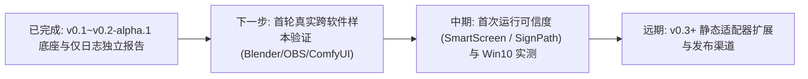

# GameCrash Kit 项目阶段总结与后续规划（v0.1 → v0.3+）

> 文档更新时间：2026-11-27 · 目标版本：`v0.2.0-alpha.1`

---

## 一、项目概述与核心设计原则

**GameCrash Kit（游戏闪退急诊室）** 是一款面向 PC 玩家与桌面排障用户的免费、开源、纯本地只读事后崩溃取证与诊断工具，用于在闪退后 30 秒内完成事后证据收集、版本化规则归因，并输出可直接发往社区或 AI 排查的零隐私脱敏急诊单。

本项目坚持五项安全与克制设计边界：

1. **纯本地只读**：仅在用户主动触发后读取本地 Windows Event Log XML、只读环境快照与用户手选日志文件，严禁篡改游戏/应用目录、系统注册表、驱动或运行文件；保存导出前通过 Win32 文件句柄标识禁止覆盖当前取证源日志。
2. **零提权（`asInvoker`）**：不弹出 UAC 提权框，不安装内核驱动，不驻留后台常驻服务，入口即直接拒绝 `.dmp` / `.mdmp` / `.hdmp` 内存转储。
3. **零联网**：安装包、主程序、规则引擎与目录探测全部离线运行（任何路径存在性查询前优先校验祖先重解析点、UNC 与本地固定盘），不发起遥测或外连请求。
4. **反作弊零接触**：不注入任何游戏进程、不读写进程内存、不附加调试器，仅作事后离线分析。
5. **两层严格白名单脱敏**：默认共享仅导出白名单字段、粗粒度安全安装来源分类、相对扫描范围与枚举映射受限提示（绝不导出私人目录路径、系统原始错误文本或原文日志）；可选结构化信号摘要仅输出剥离私有分支名后的固定模板；PNG 急诊单独立维持浅底高可读性样式。

---

## 二、已完成里程碑回顾（M0–M4 及 v0.1 → v0.2.0-alpha.1）

| 里程碑 | 核心提交 | 关键交付与里程碑能力 |
| :--- | :--- | :--- |
| **立项基线** | `9181a18` | 确认 `GameCrash Kit v0.1` 架构边界、可信刻度模型与分阶段验收标准 |
| **M0 基建与契约** | `cd85737` | `.NET 10` 解耦方案（`Core` / `Windows` / `App`）、双许可（MIT / Apache-2.0）、证据矩阵、XML 测试夹具、`TreatWarningsAsErrors=true` 严格编译 |
| **M1 核心关联与规则** | `6c320b5` | Windows Event Log（1000 / 1001 / 1002 / KP41）关联引擎、`PathClassifier`、7 项中性环境探针、10 条版本化纯 C# 规则 |
| **M2 安全日志与单窗 UI** | `bc07847` | 安全本地文件沙盒读取器（拒 UNC/设备路径/重解析点、大文件 2 MiB 尾部安全截断、UTF-8 校验）与 WPF 单窗诊断工作台 |
| **M3 导出与视觉打磨** | `7962d23` ~ `718ea6e` | 白名单 `ShareReportProjector`、Markdown 与独立离屏 `900px / 96 DPI` 浅底 PNG 导出；极夜深空赛博主题（`#0B0E14` / `#6366F1` / `#22D3EE`）、响应式工具栏及 `app.ico` 图标 |
| **M4 发布与 `v0.1.0-alpha.1`** | `e5df744` ~ `0a37e60` | 静态安全审计测试、CI/Release Workflows、第 1 轮 P0/P1 红队整改（`fba6384`）、离线沙盒 10/10 验收与首个公开 Release |
| **第 2 轮加固与 `v0.1.0-alpha.2`** | `60f6883` | `EngineVersion`/RHI 严白名单、先查重解析点且直拒 `.dmp`、重复事故不借用旧 WER、Ensure 与 OOM 截断收敛、Win32 句柄唯一标识防覆盖，干净检出 88/88 |
| **`v0.2-alpha` 第一刀：仅日志独立报告** | `64c578b` | 通用固定信号底座（`LogSignalId` + 三态 `ReportSubjectKind`）、冷启动手选日志独立出卡、`LOG-ONLY-SUMMARY@1`、独立/关联切换与 5 行离线验收矩阵（93/93） |
| **`v0.2.0-alpha.1` 单次分享完备性** | 当前基线 | 新增相对「扫描范围」与纯枚举「采集受限与数据边界说明」（Markdown + PNG 同步），全量 97/97 与离线 Windows Sandbox 11/11 复验通过 |

---

## 三、P0 / P1 对抗评审关键整改记录（`fba6384`）

1. **干净 Git 检出门禁（P0-1）**：`.gitignore` 新增 `!tests/Fixtures/EngineLogs/unity-player-gpu-lost.log` 例外并将该合成夹具纳入版本控制，确保纯净克隆可直接通过全部构建与单测。
2. **单源版本一致性（P0-2）**：统一 [Directory.Build.props](../Directory.Build.props) 为 `0.1.0-alpha.1`，新增 [AppVersionInfo.cs](../src/GameCrashKit.Core/AppVersionInfo.cs) 从程序集元数据读取版本号；`Publish-Portable.ps1` 构建与发布均注入 `-p:Version` 并校验 `ProductVersion`。
3. **跨事故日志串用隔离（P0-3）**：`MainViewModel` 改为按扫描会话与 `IncidentId` 字典独立绑定引擎日志，切换候选事故 A → B 时立即重置日志关联与诊断结论，绝不交叉污染。
4. **两层脱敏与分享防护（P0-4 + P1）**：
   - 共享报告将私有目录后缀改为安全分类标签“安装来源”（`PathClassifier.BuildShareSafeInstallSource`），`HideAppName` 同时覆盖同名故障模块（`<APP_MODULE>`）、结论与摘要；
   - `PrivacyScrubber` 补齐 2 字中文用户名、1 字主机上下文、SteamID3/Legacy ID、带引号凭据及可选时钟 `<TIME>` 擦除，标识符统一开启 IPv4/IPv6 擦除；
   - 可选日志信号摘要仅输出固定结构化模板（不再导出最后 5 行原文或自由 `ErrorMessage`）；
   - 复制 Markdown 附加 Windows 云剪贴板与历史排除标记（`CanUploadToCloudClipboard=0` / `CanIncludeInClipboardHistory=0`），导出保存禁止覆盖当前取证源日志并提醒 OneDrive 同步路径。
5. **纯本地无远程目录探测（P0-5 + P1）**：`OneDriveDocsProbe` 与有界/可取消的 `EngineLogDiscovery` 改用 `SpecialFolderOption.DoNotVerify` 且先验固定盘局部性及祖先重解析点；新增 UTF-16 LE/BE BOM 支持与 `.runtime-xml` 选择器过滤及截断拒绝；主窗/预览窗适配工作区尺寸与 `MinHeight`（`480` / `460`）。
6. **关联器与规则克制性加固（P1）**：`IncidentCorrelator` 改为两阶段 WER 匹配（优先全批唯一 `ReportId` Direct 匹配，再跑弱匹配并禁止跨冲突 ID 关联）且聚合组保留已有 WER 证据；`ThirdPartyModuleHintRule` 要求代理 DLL 路径同目录命中；`EngineOomRule` 对孤立 `0xe0000008` 降级为有限线索且不建议修改页面文件；主结论超 3 条时保留折叠补充线索与歧义限制提示。

---

## 四、已验证的质量、性能与实测结果（`v0.2.0-alpha.1`）

### 4.1 宿主机与纯净 `git archive` 检出回归测试
- **Release 构建**（`Version=0.2.0-alpha.1`）：**0 警告、0 错误**。
- **全量回归与纯净 `git archive` 快照测试**：**97 / 97 全部通过**（`Core.Tests` 53 + `Windows.Tests` 31 + `App.Tests` 13，0 失败 0 跳过）。
- **宿主机 M4 发布门禁**（`Verify-ReleaseGate.ps1`）：清单（`asInvoker`）、包完整性（0 测试工具泄漏）、只读哈希不变性、20 次真实扫描基准全部 `PASS`（`Min=28.1ms | P50=29.1ms | P95=35.4ms | Max=58.2ms`）。

### 4.2 离线 Windows Sandbox 无人值守验收（`2026-11-27 09:50:26 +08:00`）
在 **完全断网（`Networking=Disable`）、无 `.NET 10` 预装、非提权 `WDAGUtilityAccount`** 的 Windows 11 24H2（Build `26100.9457`）沙盒中，无人值守套件执行 **11 / 11 项全部 `PASS`**：

| 验收项 | 状态 | 实测指标 |
| :--- | :--- | :--- |
| `Check1a.OfflineNoNet10Environment` | **PASS** | `SandboxUser=True`, `Offline=True`（DNS 阻断）, `HostNet10Preinstalled=False` |
| `Check1b.CleanPortableArtifact` | **PASS** | `ExeExists=True`, `ProductVersion=0.2.0-alpha.1...`, `LeakedTestBinaries=[]` |
| `Check2.RealCrashCapture` | **PASS** | 实测捕获真实 `SyntheticCrashTool.exe` `Event 1000`（`0xc0000005`） |
| `Check2b.SampleLogReadOnly` | **PASS** | Unity 日志解析成功（`GpuLost=True`），SHA-256 与修改时间 100% 不变 |
| `Check3c.StandaloneLogColdStart` | **PASS** | 冷启动独立诊断 `StandaloneLogOnly`，触发 `[ENGINE-GPU-LOST@2, LOG-ONLY-SUMMARY@1]`，Markdown 完备性通过且导出 `900×958` px PNG，`Leaks=[]` |
| `Check3b.ReportVersionConsistency` | **PASS** | `ReportAppVersion=0.2.0-alpha.1 == Expected=0.2.0-alpha.1` |
| `Check3.RuleEngineCoverage` | **PASS** | 关联日志触发 `[ENGINE-GPU-LOST@2, EXCEPTION-AV@1, APP-CRASH@1]` |
| `Check4a.MarkdownPrivacyScrub` | **PASS** | 导出 3660 字节 Markdown（含 `扫描范围`、`最近 2 小时` 与安全安装来源），`Leaks=[]` |
| `Check4b.PngEmergencyCard` | **PASS** | 导出 `900×1331` px、`96.0×96.0 DPI`、`153841` 字节 PNG，浅底画布校验通过 |
| `Check5.LatencyBenchmark20Runs` | **PASS** | 沙盒连续 20 次扫描：`Min=29.0ms` / `Avg=32.7ms` / `P95=35.8ms` / `Max=36.1ms` |
| `Check6.PortableGuiSmokeLaunch` | **PASS** | 免 UAC 启动绿色便携版 GUI（主窗口句柄就绪耗时 `1ms`） |

### 4.3 本地沙盒验证 ZIP（本地构建，非 GitHub 云端资产）
- 本地沙盒归档包：`publish/GameCrashKit-v0.2.0-alpha.1-win-x64.zip`（`62.47 MB`）
- 本地沙盒包 SHA-256：`0aa8046671d91c7b497a3af7072fcdd0ac98aed602b0c816620ea42e7999e022`（仅对应本机沙盒构建包；GitHub Releases 云端 CI 产出的 ZIP 因其自身构建环境差异而对应 Releases 页面附带的 `.SHA256SUMS.txt`，公开下载请始终以 Releases 页面 `SHA256SUMS.txt` 为准）

---

## 五、当前边界与后续计划

### 下一步 1：首轮真实跨软件与游戏公开样本盲测（近期）
- 不等外部玩家，使用公开可复现/公开支持样本做独立冷启动对照测试：
  1. **Blender**：用已知公开最小复现文件分别在受影响版与修复版上实跑，核对实际退出进程、命中信号与修复版差异。
  2. **OBS Studio**：选取社区公开 Windows 支持日志做盲筛，对比急诊单与社区维护者人工结论，评估是否增加最小 OBS 静态文本解析适配器。
  3. **ComfyUI Desktop**：验证 Python 子进程异常退出的识别与壳层隔离表现。

### 下一步 2：真机多环境实测与首次运行可信度（中短期）
- 在 **Windows 10 22H2**、英文/繁体系统、125%–200% DPI 缩放及普通标准账户浏览器下载场景下验证便携包首次运行（SmartScreen）体验，并评估接入免费开源 Authenticode 代码签名（如 SignPath）。
- **继续坚持暂缓清单**：不引入动态 DLL/脚本插件机制、不引入可下载规则 DSL、不做全机软件无预算自动盘点。
