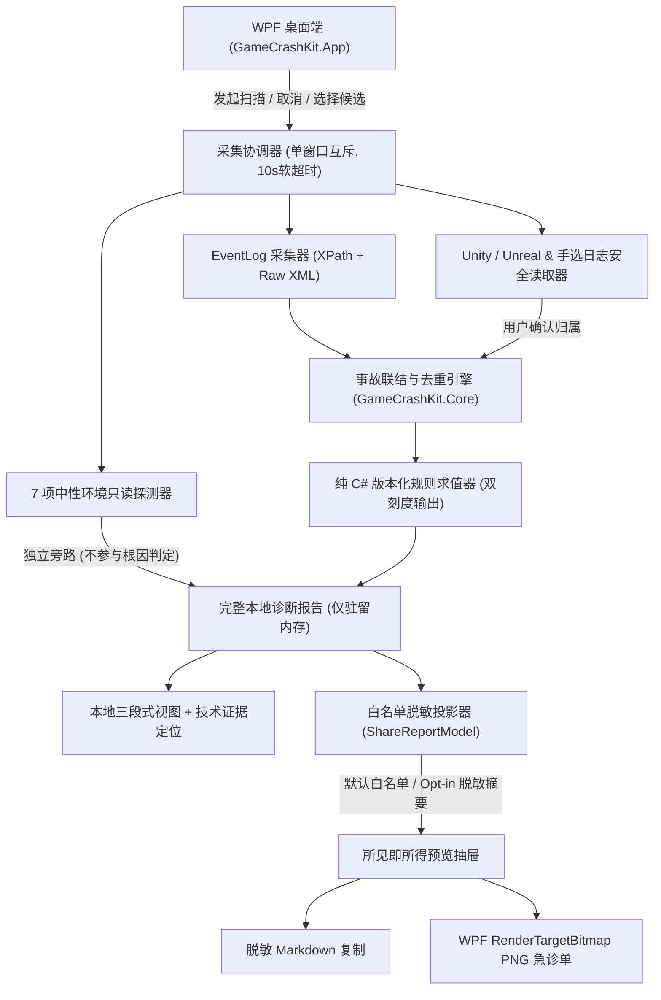

# GameCrash Kit（暂名：游戏闪退急诊室）v0.1 最终项目方案与工程立项规格书

> **文档状态**：最终立项冻结基线（融合初版规格书、交叉评审回执及发起人 5 项决策确认）  
> **适用范围**：工程研发启动、架构实现、测试夹具建设、Alpha 试用及 v0.1.0 正式发布验收  
> **立项基线**：综合初版项目规格书（v0.1 草案）与评审修订立项文档，并完成产品边界与技术方案终审锁定

---

## 1. 立项决策锁定总览

本方案吸收初版面向中文玩家“闪退后 30 秒急诊”的实用体验，全面采纳评审稿对**证据严谨性、归属分离、隐私白名单与系统底层事实**的纠偏，并正式锁定以下产品与工程边界：

| 维度 | 最终锁定方案 | 决策依据 |
| :--- | :--- | :--- |
| **产品取向** | **融合版**：严谨归因 + 独立「中性环境事实快照」 | 保留中文玩家高频痛点体检价值，同时与崩溃归因严格隔离，杜绝越权断言 |
| **引擎/Mod 日志** | 通用 Windows 事件 + **Unity / Unreal** 崩溃日志（只读扫描 + 手选单文件） | 优先覆盖主流 PC 游戏；Minecraft Fabric 等单游戏/Mod 框架延后至 v0.2 适配器 |
| **隐私与分享** | **默认严格字段白名单** + **可选勾选**附带受限脱敏报错摘要 | 默认零自由文本泄漏风险；遇未知崩溃时允许用户预览确认后补充高信号报错行 |
| **目标系统** | **Windows 10 22H2+ & Windows 11 x64**（中/英系统语言矩阵实测） | 兼顾国内大量 Win10 玩家，并通过双系统纯净 VM 实测保障兼容性 |
| **发版与验收** | **质量驱动**，不设硬性 7 天死线；先出 `v0.1-alpha` 小范围试用，过 8 项硬门槛再标 `v0.1.0` | 用真实样本与试用结果驱动发布，避免仓促交付导致误归因口碑受损 |
| **状态与扫描窗** | **默认无持久化**（即用即走，关闭即清空内存）；扫描窗默认 `2 小时`，可切 `24 小时` / `7 天` | 零隐私落盘负担；默认 2 小时兼顾急诊速度与低噪音，24h/7d 满足复发聚合排查 |
| **规则引擎实现** | v0.1 采用**纯 C# 版本化规则函数**（`RULE-ID@1`），不做通用 JSON DSL | 避免过早抽象与解析器缺陷，保留强类型安全与表驱动正/反例回归测试 |
| **开源协议** | **`MIT OR Apache-2.0` 双许可** | 消除对 GPL 商用限制的误解，提供最友好的开源协作与专利保障 |

---

## 2. 产品定位、竞品差异化与明确边界

### 2.1 一句话定位
面向中文 Windows PC 玩家与轻度 Mod 玩家的**开源、纯本地、零提权、只读式事后游戏闪退取证与脱敏急诊单工具**。

### 2.2 核心用户痛点与产品闭环
PC 游戏发生无提示闪退、卡死或弹窗退出后，普通玩家往往不知道去哪找日志、看不懂事件查看器异常码，去 NGA / 贴吧 / B 站 / 小黑盒 / QQ 群求助或问网页 AI 时又缺乏结构化上下文。GameCrash Kit 卡位在**“闪退发生后的事后急诊”**：

1. **零配置事后取证**：无需提前常驻后台；闪退后双击打开，默认扫描近 2 小时（可切 24 小时 / 7 天），按时间倒序展示清晰候选，由用户确认本次事故。
2. **诚实分级诊断**：严格区分**「归属强度」**（证据是否属于这次事故）与**「证据强度」**（证据能支撑什么结论）；同时独立展示可核验的本机中文环境事实。证据不足时坦白告知未知、交代已查与缺失范围，并给出下一步补证建议。
3. **一键脱敏急诊单**：由同一份不可变脱敏模型生成 **PNG 急诊长图**（适配微信/QQ/图文社区压缩回读）与 **脱敏 Markdown**（适合论坛文字帖或免费粘贴给任意网页 AI）。

### 2.3 竞品对照与差异化（基于公开资料，M0 阶段补做发行版实测）
* **对照 `game-crash-doctor`**：无需 AI 宿主环境与对话交互，独立原生 WPF 界面降低普通玩家门槛；且绝不将邻近 TDR 自动升格为高置信度驱动根因。
* **对照 `CrashScope`**：放弃常驻遥测、实时采样与 SQLite 历史库，聚焦轻量级“事后即用即走、零配置、零落盘”体验。
* **对照 `CRASQ One`**：完全开源、规则版本与误归因回归测试集公开可复跑，每条结论均可追溯原始证据定位与采集覆盖范围。

### 2.4 v0.1 明确非目标（Explicit Non-Goals）
为守住安全信誉并保证首版完成度，v0.1 **严格不做**：
* ❌ **内置 LLM API 调用与聊天界面**（留至 v0.2+ 作为显式 Opt-in 选项）。
* ❌ **任何写操作与自动修复**（不改注册表、不开启 `LocalDumps`、不下载 DLL、不执行 DDU/驱动回滚、不修改游戏或 Mod 文件）。
* ❌ **任何 UAC 提权**（锁定 `asInvoker`，不访问受限 `C:\Windows\Minidump`，不读取或导出 `.dmp` 内存内容）。
* ❌ **常驻后台、实时帧率/ETW 硬件监控、遥测上报与自动更新**。
* ❌ **默认本地报告历史持久化或数据库**（仅在当前会话扫描窗内动态聚合重复崩溃）。
* ❌ **单游戏深度 Mod 排查**（如 Minecraft Fabric/Forge、Skyrim 等，留至 v0.2+ 独立适配器）。
* ❌ **全盘递归扫描与远程规则脚本热更新**。

---

## 3. 核心安全、反作弊与隐私工程铁律

所有实现代码与 PR 必须无条件满足以下 6 条可验证约束：

1. **反作弊零侵入行为约束（可经系统 I/O 与 API 审计验证）**
   严禁对任何游戏或第三方进程调用 `OpenProcess`、`ReadProcessMemory`、`EnumProcessModules`、DLL 注入或附加调试器。覆盖层/常见软件探测仅允许使用全局只读进程名快照（`CreateToolhelp32Snapshot(TH32CS_SNAPPROCESS, 0)`）及文件系统/注册表只读查询。
2. **100% 只读采集与零提权**
   应用程序清单锁定 `requestedExecutionLevel level="asInvoker"`。整个扫描、解析与展示链路不产生任何磁盘写入与网络出站；唯一磁盘写入操作为用户主动触发并确认保存路径的导出动作。遇权限拒绝、服务关闭或系统策略拦截时，按数据源独立优雅降级并显式告知用户。
3. **跨语言 XML 结构化解析与防御性读取**
   严禁依赖 `EventRecord.FormatDescription()` 本地化文案做正则匹配；统一使用 `EventRecord.ToXml()`。XML 解析强制关闭 DTD 与外部实体（`DtdProcessing.Prohibit`、`XmlResolver = null`）。优先按字段名读取，仅对夹具验证过的 Event 版本启用位置索引映射；字段缺失、超限或版本未知时标为未知并降级，绝不猜测。
4. **手选与扫描文件安全沙箱边界**
   所有日志文件读取（自动发现的 Unity/UE 日志及用户手选单文件）必须满足：
   * 仅限本机固定磁盘的普通文件，拒绝 UNC 路径、设备路径、网络映射盘，以及目标文件或任意祖先目录中的重解析点（Reparse Point / Symlink / Junction）；
   * 以只读共享模式（`FileShare.ReadWrite | FileShare.Delete`）打开句柄，校验打开句柄的最终规范路径（`GetFinalPathNameByHandle`）仍在允许的本地目录范围内后再读取；
   * 单文件上限读取末尾 `2 MiB`（超过时跳过首个不完整行并标记截断与字节区间）；验证 UTF-8 编码（允许 BOM），限制单行最大长度，所有正则强制设置显式 `MatchTimeout` 或改用无回溯扫描；
   * 严禁解压归档、严禁递归追踪日志内提及的其他路径。
5. **双层隐私保护（默认严格白名单 + 二次确认可选脱敏摘要）**
   * **默认层（Strict Whitelist）**：Markdown 与 PNG 共用同一个不可变 `ShareReportModel`，仅允许通过白名单校验的结构化字段（程序名、故障模块名、脱敏路径后缀、受限错误码、事件时间、规则版本、模板化结论及中性环境事实项）进入分享模型。原始 XML、任意自由文本、绝对路径、启动命令行、Report ID、完整堆栈、SID、IP、用户名与机器名**永不进入默认分享模型**。
   * **可选层（Opt-in Scrubbed Excerpt，默认关闭）**：用户可在分享预览抽屉主动勾选「附带受限脱敏报错摘要」（用于向社区高手或网页 AI 提供高信号线索，硬限制最多 5 行 / 600 字符，仅来自结构化提取的引擎错误行或核心错误字段）。该摘要强制经过隐私擦除管线（替换本机用户名、机器名、`%USERPROFILE%`、SID、IPv4/IPv6、邮箱、17 位 Steam64 ID、常见 Token/Key 参数及控制字符），并在预览区高亮展示。
   * **所见即所得**：Markdown 预览与剪贴板复制内容逐字一致；PNG 预览与最终保存文件为同一份渲染图像；用户可在预览中一键隐藏程序名或精确时间戳。
6. **诚实归因与零危险修复引导**
   绝不输出伪造的“故障概率百分比”。禁止仅凭通用系统 DLL（`ntdll.dll`、`KERNELBASE.dll`）、通用异常码（`0xC0000005`）、邻近 `4101` 或中性环境项推断硬件损坏，或引导用户执行 DDU、回滚驱动、关闭 HVCI/内存完整性等高风险操作。

---

## 4. 证据来源与分级支持矩阵

### 4.1 v0.1 核心必保来源（Core Required）

| 来源 | 采集内容与限定方式 | 定位与判定边界 |
| :--- | :--- | :--- |
| **`Application / Application Error / 1000`** | XPath 过滤，提取应用名、故障模块、异常码、故障偏移、应用路径、故障 PID/启动时间、Report ID（按实际版本） | **主闪退锚点**。`ntdll.dll`、`KERNELBASE.dll` 等通用系统模块仅如实标示为崩溃落点，不直接指认系统损坏 |
| **`Application / Application Hang / 1002`** | XPath 过滤，提取无响应程序、路径、等待类型/时长等已验证字段 | **无响应卡死锚点**。界面明确标示「无响应」，与闪退事件分开处理 |
| **`Application / Windows Error Reporting / 1001`** | XPath 过滤，仅解析夹具已证实的报告类型（如 `APPCRASH`、`AppHangB1` 等）与字段 | 优先联结到对应 `1000/1002` 作为补充证据；孤立有效记录仅作为「仅有 WER 报告」弱候选，严禁独立断言具体闪退根因 |
| **`System / Microsoft-Windows-Kernel-Power / 41`** | XPath 过滤，仅记录时间与基本事件参数 | **纯系统背景**。该事件产生于异常掉电/硬重启后的**下一次开机**，时间不等于游戏闪退时刻，绝不单独创建游戏候选 |
| **Unity 引擎日志** | ① 只读启发式定位 `%USERPROFILE%\AppData\LocalLow\<Company>\<Product>\Player.log`（及 `Player-prev.log`，仅取修改时间落入当前扫描窗的候选）；② 支持用户手选单个日志文件 | 仅提取结构化白名单信号（引擎版本、渲染后端、`DXGI_ERROR_DEVICE_*`、明确 OOM 标记及受限尾部异常摘录）。提示可能被后一次启动覆盖，**必须由用户确认归属** |
| **Unreal 引擎日志** | ① 只读定位 `%LOCALAPPDATA%\<Game>\Saved\Crashes\*\CrashContext.runtime-xml`（按修改时间过滤）；② 支持用户手选 `CrashContext.runtime-xml` 或 `.log` | XML 禁 DTD 解析，提取 `<RHI>`、`<CrashType>`、`<ErrorMessage>` 等受限字段；调用栈仅限本地技术视图折叠查阅，默认不进分享模型，**由用户确认归属** |
| **通用手选单文件兜底** | 用户拖入或浏览选择本机单个 `.log` / `.txt` / `.xml` 崩溃日志 | 按第 3 节安全沙箱规则受限读取，用于基础元数据展示与可选脱敏摘录辅助求助 |

### 4.2 中性中文环境事实快照（Verified Environment Facts，与归因严格分离）

所有探针均在普通用户权限下只读执行（单探针超时 2s、异常隔离），独立呈现在报告的**「本机环境事实（非归因参考）」**区块，视觉采用中性「信息 / 留意」徽标，绝不越权断言其为本次闪退根因：

| 序号 | 检查项 | 只读探测方式 | 事实呈现规范（严格遵守语义边界） |
| :--- | :--- | :--- | :--- |
| 1 | **显卡与驱动版本信息** | WMI `Win32_VideoController`（`Name`、`DriverVersion`、`DriverDate`） | 如实标注为**“驱动版本发布日期”**，绝不误判为“本机安装日期” |
| 2 | **目标游戏路径特征** | 仅校验已选中事故的可执行文件内存路径 | 标注是否包含非 ASCII（中文/特殊符号）或总长度 `> 260` 字符（不把完整绝对路径写入分享） |
| 3 | **文档目录 OneDrive 同步** | 检查 `SpecialFolder.MyDocuments` 路径与重解析点属性 | 仅客观提示“文档目录位于 OneDrive 同步范围，部分游戏读写存档/配置时需留意同步锁” |
| 4 | **VC++ 运行库状态** | 读取 `HKLM\SOFTWARE\Microsoft\VisualStudio\14.0\VC\Runtimes\{x64,x86}` | 显示 x64 / x86 安装状态与版本号；缺失时提供微软官方下载页链接 |
| 5 | **虚拟内存 / 页面文件** | 读取 `PagingFiles` 注册表及 `Win32_PageFileUsage` | 展示当前配置模式与总量；仅在“已禁用”或总量 `< 4 GB` 时标为「留意」 |
| 6 | **当前运行中的常见覆盖层进程** | `TH32CS_SNAPPROCESS` 全局进程名快照（零 `OpenProcess`） | 明确注明为**“扫描瞬间正在运行”**（如 RTSS、Afterburner、Discord、NVIDIA/Xbox Overlay 等），不声称其参与了历史崩溃 |
| 7 | **系统基础与区域设置** | OS 版本构建号、物理内存总量、`GetACP()`、Beta UTF-8 开关及 HVCI 注册表只读状态 | 纯客观配置摘录，方便社区排障对照；**严禁建议关闭 HVCI 或系统安全防护** |

### 4.3 条件准入实验来源（Conditional - 须通过 M0 实测门槛后方可进入支持矩阵）
* **`System / Display / 4101`（及 `nvlddmkm` 14/153、`amdkmdag`、`igfx`）**：须在 Win10 22H2 与 Win11 x64 真实机器上验证 XML 结构、Provider 名与字段版本。即使通过准入，单凭事件时间邻近（`±120s`）**也仅作为系统背景呈现**，不能直接断言显卡驱动根因。
* **本地 WER 文件与转储元数据（`ReportArchive\*\Report.wer`、`CrashDumps` 元数据）**：仅在实测确认普通权限稳定性与零敏感泄露后再行纳入，且永不读取 `.dmp` 内存内容。

---

## 5. 系统架构与核心算法设计

### 5.1 数据流与模块分层



### 5.2 解决方案目录结构
```text
GameCrashKit/
├── src/
│   ├── GameCrashKit.Core/                # 零 WPF、零 Win32、零网络依赖（纯领域与测试核心）
│   │   ├── Models/                       # ScanRequest, SourceCoverage, EvidenceItem, CrashIncident, DiagnosisFinding, EnvironmentSnapshot
│   │   ├── Correlation/                  # 事故主键、WER 联结去重、窗口内重复聚合、噪音降权排序
│   │   ├── Rules/                        # 纯 C# 版本化规则函数 (IRule / RULE-ID@1) 与合并排序器
│   │   ├── Parsers/                      # Event XML / Unity / Unreal 结构化纯解析逻辑（吃流/字符串）
│   │   ├── Privacy/                      # ShareReportModel 白名单投影器 + Opt-in 摘要脱敏擦除管线
│   │   └── Exporters/                    # Markdown 渲染器
│   ├── GameCrashKit.Windows/             # Windows 原生只读适配层
│   │   ├── EventLog/                     # EventLogQuery + EventLogReader（支持测试读本地 .evtx，生产 UI 无导入）
│   │   ├── FileSystem/                   # 安全单文件打开、重解析点/UNC 拒绝、句柄最终路径校验、末尾 2MiB 读取
│   │   └── Environment/                  # 7 项只读环境探针（WMI/Registry/Toolhelp32/GetACP）
│   └── GameCrashKit.App/                 # WPF + WPF-UI 单窗口 MVVM 应用
│       ├── ViewModels/                   # 主窗口状态机、候选消歧、预览与导出控制
│       ├── Views/                        # 三段式报告、证据定位面板、环境快照栏、预览抽屉
│       └── Rendering/                    # 96 DPI 固定像素 PNG 急诊单离屏渲染器
├── tests/
│   ├── GameCrashKit.Core.Tests/          # 表驱动联结/规则正反例单测、脱敏断言、报告快照回归
│   ├── GameCrashKit.Windows.Tests/       # Win10/Win11 XML/EVTX 夹具解析与权限/超时降级测试
│   ├── Fixtures/                         # 脱敏真实与合成事件 XML、Unity/UE 样本及易混淆负例
│   └── SyntheticCrashTool/               # 开发/VM 隔离测试专用可控崩溃夹具（不随发行包分发）
└── docs/
    ├── SPEC_v0.1.md                      # 本规格书
    ├── PRIVACY.md                        # 白名单字段清单与隐私承诺
    └── SUPPORT_MATRIX.md                 # 经实测的 OS/语言/来源支持矩阵
```

### 5.3 采集限制与并发控制
* **单窗口互斥**：同一时间仅允许一个活跃扫描任务；支持随时取消，取消后立即停止向 UI 推送结果，并在后台原生调用返回后释放 `EventLogReader` 与 `EventRecord`（释放前禁止重叠发起下一次读取）。
* **硬限制与软超时**：按本地 UTC 时间窗快照构造 XPath 查询；单频道最多读取 `1,000` 条；整次扫描总软截止 `10 秒`，到点即展示已收到的部分结果并在覆盖状态栏标明超时来源（若实测中频繁出现长时间阻塞的系统调用，列为正式发布阻塞缺陷）。

### 5.4 确定性事故联结、降噪与聚合规则
1. **主键与锚点**：单次扫描快照内事件主键为 `(Channel, RecordId)`。`1000` 创建「应用故障」锚点，`1002` 创建「应用无响应」锚点；未匹配的已验证 `1001` 仅作「仅有 WER 报告」弱候选。
2. **`1001` 严格联结规则**：
   * **优先级 1（归属 = `直接`）**：相同且非空的 `ReportId`，且事件类型兼容、程序身份无冲突、目标锚点唯一；
   * **优先级 2（归属 = `可能`）**：规范化完整路径精确一致 + 类型兼容 + `±120 秒` 内唯一匹配；当路径字段缺失时，仅允许经夹具证实的**故障进程 PID 与进程启动时间双一致**作为替代；
   * **禁止项**：严禁仅凭 PID、进程名子串或时间邻近自动联结；严禁误用 `System/Execution/@ProcessID`（其为事件发布者上下文，非故障进程 PID）；多解歧义时保持独立并展示提示；合并后的 `1000/1002 + 1001` 计为一条事故，不重复加权。
3. **候选消歧、降噪与当前窗口聚合**：
   * 结合常见游戏库路径特征（`steamapps`、`Epic Games`、`WeGame`、`XboxGames`、`GOG`、`miHoYo`、`Riot` 等）与内置系统噪音排除表（`SearchHost.exe`、`Widgets.exe`、`explorer.exe` 等），优先将疑似游戏候选置顶，同时提供一键切换「显示全部应用事件」开关；
   * 同名不同路径的进程展示脱敏路径后缀消歧；
   * 当前扫描窗内（尤其是 `24h` / `7d`）同一 `AppName + ModuleName + ExceptionCode` 的重复锚点可折叠展示“本窗口内共出现 N 次”（保留每次时间点展开），但重复次数仅作频率参考，不提高单次事故的证据强度。
4. **背景与引擎日志关联**：
   * `Kernel-Power 41` 按完整扫描窗列在系统背景；通过准入的 `Display 4101` 在锚点 `±120s` 内仅列「邻近图形背景」；
   * 自动发现或手动选入的 Unity/Unreal 日志需由用户确认归属（标为「手选」），若日志仅含 `HH:mm:ss` 无日期则按原值显示，不臆测 UTC。

### 5.5 双刻度模型与 v0.1 纯 C# 版本化规则集

每条诊断结论同时标注两条相互独立的刻度，严禁混为一谈：
* **归属强度（Attribution）**：`直接`（主锚点或唯一 `ReportId`） / `可能`（路径+时间窗唯一弱联结） / `手选`（用户确认的引擎日志文件） / `仅邻近`（无进程归属的系统背景事件） / `未关联`。
* **证据强度（Evidence Strength）**：`明确记录`（事件或引擎日志直接陈述该事实） / `有限线索`（可观察信号但因果未定，或归属仅为可能） / `证据不足`（当前范围无法支撑有效判断）。缺字段、未知版本、文件截断按单条发现独立降级。

| 规则 ID 与版本 | 触发条件与排除约束 | 证据强度上限 | 结论陈述与保守行动建议 |
| :--- | :--- | :--- | :--- |
| `APP-CRASH@1` | 选中并成功解析 `1000`；缺字段时保留未知 | `明确记录` | 「Windows 记录到应用异常退出」。提示核对程序与退出时刻，附模块名与异常码供排查；若模块为 `ntdll.dll`/`KERNELBASE.dll` 等通用系统 DLL，明示仅为崩溃落点 |
| `APP-HANG@1` | 选中有效 `1002`；无 `1000` 时独立处理 | `明确记录` | 「Windows 记录到应用无响应」。提示记录卡死前所处场景及等待时长 |
| `WER-REPORT@1` | 已验证类型的 `1001`；未知类型不触发 | `明确记录`（独立）/ 补充信息（已联结） | 已联结时作补充元数据；弱联结标「可能对应」；独立存在时提示仅有错误报告、缺少主故障事件 |
| `EXCEPTION-AV@1` | 目标 `1000` 结构化字段精确等于 `0xC0000005`（禁止从自由文本抓取） | `明确记录`（事实）/ 根因未知 | 「进程发生内存访问违规（根因未知）」。明确注明单凭此码不能归咎内存条、显卡或 Mod，引导核查是否在同一场景复现并补充引擎日志 |
| `ENGINE-GPU-LOST@1` | 用户确认的 Unity/Unreal 日志结构化匹配明确图形设备丢失标记（`DXGI_ERROR_DEVICE_REMOVED/HUNG/RESET`） | `明确记录`（归属=`手选`） | 「该引擎日志记录图形设备失去响应」。若同步存在通过准入的邻近 `4101` 则附注为时间吻合背景；说明驱动、游戏渲染缺陷或超频/降压均可能触发，先排查超频与覆盖层 |
| `ENGINE-OOM@1` | 用户确认的引擎日志明确记录显存/内存耗尽（`Out of video memory` / `Ran out of memory`），或 `1000` 异常码精确为 `0xE0000008` | `明确记录` | 「记录到内存或显存不足信号」。引导结合环境快照中的虚拟内存/页面文件与当前画质/显存配置复测 |
| `THIRD-PARTY-MODULE-HINT@1` | 目标 `1000` 故障模块精确命中常见第三方注入/叠加层/Hook DLL 清单（如 `RTSSHooks*`、`DiscordHook*`、`OverlayVulkan*`、`dinput8.dll`、`version.dll` 等） | `有限线索` | 「崩溃落点位于常见第三方覆盖层或加载器模块」。说明部分游戏/Mod 合法依赖该类 DLL，建议临时关闭对应覆盖层或移出对应模块做对照复测 |
| `RUNTIME-MODULE-HINT@1` | 目标 `1000` 故障模块精确为 `vcruntime140*.dll`/`msvcp140*.dll`/`ucrtbase.dll` | `有限线索` | 「崩溃落点位于 Visual C++ 运行库模块」。联动参考环境快照中 VC++ 状态，建议核验或修复微软官方运行库（附官方直链） |
| `SYSTEM-CONTEXT@1` | 扫描窗内存在 `Kernel-Power 41`，或锚点 `±120s` 内存在通过准入的 `Display 4101` | `有限线索`（归属=`仅邻近`） | 如实陈述「系统记录到上一次异常关机」或「附近存在显示驱动恢复事件」，请用户核对当时是否黑屏或整机重启，严禁直接断言硬件/驱动根因 |
| `UNKNOWN@1` | 无有效锚点或仅有未归属背景 | `证据不足` | 「在当前扫描范围内未找到足够证据」。列明已查来源、跳过/截断原因，引导切换 24h/7d 时间窗或手动选入游戏日志文件 |

> **呈现治理规则**：发现列表按“具体观察 → 宽泛事实”排序，同一事实自动合并，最多展示 **3 条主要发现**；冲突证据并列呈现并收敛到最窄可成立陈述；低强度线索不得挤占已确认的直接事实。每条规则必须随源码附带：**依据说明、输入门槛、至少 1 份正例、1 份易混淆负例及 1 份报告快照**。

---

## 6. 交互体验、PNG 急诊单与打包规范

### 6.1 单窗口状态机与布局
* **完整覆盖交互状态**：未扫描 → 扫描中（带进度与取消按钮）→ 候选选择（默认 2h，可切 24h/7d；含“显示全部应用”开关与“手选 Unity/Unreal/任意单个日志文件”入口）→ 报告展示（完整 / 部分完成含降级说明 / 无记录证据不足 / 扫描失败）→ 分享预览抽屉。
* **右侧三段式报告结构**：
  1. **结论与行动卡**：最多 3 条主要发现（含归属/证据双徽标与规则版本号）+ 1 项最有依据的下一步；
  2. **可折叠技术证据与时间轴**：显示来源定位（频道 / Provider / EventID / Version / RecordId 或日志字节区间）、背景事件时间线及本地查看的受限明细；
  3. **本机环境事实快照栏**：7 项中性只读环境信息，明确标注“中性事实参考，非崩溃归因”。
* **可访问性**：全主流程支持键盘导航（Tab / 方向键 / Enter / Esc）；所有状态与强度均以清晰中文文字标注，不单独依赖红黄绿颜色区分。

### 6.2 分享预览抽屉与 PNG 急诊单规格
* **双格式同源**：由同一份不可变 `ShareReportModel` 生成 Markdown 文本与 PNG 图像。
* **预览可控项**：
  * `[ ]` 隐藏程序名称（默认关，勾选后以 `<APP>` 脱敏替代）
  * `[ ]` 隐藏精确时间戳（默认关，勾选后仅保留日期与相对时间差）
  * `[ ]` **附带受限脱敏报错摘要（默认关）**：仅在存在引擎日志或有效错误摘录时可用；勾选后实时高亮展示经脱敏管线擦除后的 ≤5 行 / ≤600 字符摘要，由用户确认无私密信息后再复制或保存。
* **PNG 离屏渲染规范**：
  * 首选 WPF `RenderTargetBitmap` + `PngBitmapEncoder` 实现固定逻辑宽度（初版基准 `900px`，强制锁定 `96 DPI` 布局并显式执行 `Measure`/`Arrange`），单张控制在 1～2 个手机屏高度内；若验证中发现在高缩放/无头测试下存在兼容短板，可无痛切换 `SkiaSharp` 渲染同一模型。
  * 包含：软件版本与脱敏徽标、事故摘要三元组（程序/模块/异常码）、最多 3 条发现与双刻度标识、下一步建议、简明环境事实摘录、（可选）已脱敏报错摘要。
  * 图像编码或保存失败时给出明确错误并支持重试，同时保持 Markdown 复制完全可用。

### 6.3 编译打包与分发
* **构建命令**：`dotnet publish -c Release -r win-x64 --self-contained true`（显式关闭 trimming，避免 WPF 与 WMI 反射异常）。
* **发布资产**：目录绿色便携 ZIP（无需预装 .NET Desktop Runtime）、完整开源代码、`LICENSE-MIT` + `LICENSE-APACHE`、SHA-256 校验文件、`PRIVACY.md`、`SUPPORT_MATRIX.md`。

---

## 7. 质量驱动里程碑与正式发布硬门槛

取消硬性 7 天交付压力，按以下 5 个阶段循序推进，通过上一阶段退出条件再进入下一阶段；试用反馈可随时回流修正：

| 阶段 | 核心交付任务 | 阶段退出条件（Exit Criteria） |
| :--- | :--- | :--- |
| **M0：证据基线与竞品实测** | ① 在干净 Win10 22H2 与 Win11 x64（中/英系统语言）采集验证 `1000`/`1001`/`1002`/`KP 41` 及实验源 `4101` 的真实 XML 结构与版本号；② 收集 ≥2 组真实游戏崩溃样本、Unity/Unreal 真实崩溃样本与 `SyntheticCrashTool` 样本；③ 实测直接竞品发行版并记录事后流程对照基线 | 双系统与双语言事件字段矩阵定稿；明确哪些实验源通过准入、哪些继续保留未验证状态；核心样本夹具库就位 |
| **M1：核心只读引擎与严谨关联** | ① 搭建 `.NET 10` 三层解决方案；② 完成 EventLog XPath 采集、1000 条/10s 超时、取消与按源降级；③ 实现事故联结/去重/窗口聚合、7 项中性环境只读探针、纯 C# 版本化规则与表驱动正/反例单测 | 普通用户权限可从真实与受控崩溃生成确定性诊断；同名异路径、PID 复用、迟到 WER、未知版本与邻近系统背景反例全部通过 |
| **M2：引擎日志与 WPF 闭环** | ① 实现 Unity/Unreal 安全只读发现与手选单文件沙箱读取；② 完成 WPF-UI 单窗口全状态机、候选消歧、键盘操作、三段式报告与证据定位面板；③ 打通「证据不足」兜底体验 | 普通玩家与引擎日志排查流程均可在单窗口闭环跑通；大日志、符号链接拒绝、文件变动与权限受限均能安全降级 |
| **M3：脱敏急诊单与 Alpha 打包** | ① 实现白名单 `ShareReportModel` + Opt-in 脱敏摘要管线；② 实现所见即所得 Markdown 与 PNG 预览/导出；③ 完成 100%~200% DPI 缩放、手机及主流社交平台压缩回读测试；④ 记录 4C/8G/SSD VM 性能基线 → **输出 `v0.1-alpha`** | 隐私脱敏断言与多平台 PNG 回读通过；默认 2h 窗口扫描 P95 ≤ 5s；`v0.1-alpha` 便携包可供受邀试用 |
| **M4：双系统验收、试用与正式发布** | ① 在无预装 .NET 的干净断网 Win10 22H2 & Win11 x64 VM 中完成端到端实测与 ProcMon I/O 审计；② 招募 ≥10 名试用者覆盖普通闪退、引擎日志与证据不足场景并记录结果；③ 修复全部阻断缺陷并重跑回归 → **发布正式 `v0.1.0`** | 下列 **AC-01 至 AC-08** 全部通过；完整源码、双许可文件、校验值与实测支持矩阵同步公开 |

### 正式发布 8 项硬验收门槛（AC-01 ~ AC-08）
* **AC-01 普通玩家主闭环**：至少 2 组真实游戏崩溃样本 + 受控 `SyntheticCrashTool` 样本，扫描后准确呈现候选并可核对证据定位；同步验证「无响应（1002）」与「无记录（证据不足）」闭环。
* **AC-02 归属、联结与去重**：`1001` 正确合并到目标锚点且不重复计票；同名异路径、PID 复用、多候选歧义、迟到 WER、未知事件版本与跨频道同号事件均零错误合并；选中候选后分享内容仅含该事故与明示背景。
* **AC-03 零越权误归因**：所有易混淆负例零误判——邻近 `4101` 不判驱动根因、孤立 `KP 41` 不创建游戏事故、通用系统 DLL 与 `0xC0000005` 不指认硬件或第三方软件、中性环境快照绝不触发 DDU/关 HVCI 建议。
* **AC-04 引擎日志与文件安全**：通过 Unity 与 Unreal 真实崩溃样本、正常日志、截断日志、非 UTF-8 编码、扫描期文件变动测试；实测拦截 UNC、网络盘与重解析点/符号链接，读取上限严格锁定末尾 2 MiB。
* **AC-05 性能、超时与交互韧性**：4 逻辑核 / 8 GB / SSD 虚拟机重复运行 20 次，默认 2h 窗口扫描 P95 ≤ 5 秒；记录 PNG 生成与取消响应时间；大日志、拒访与超时呈现部分覆盖而不卡死界面。
* **AC-06 分享一致性、隐私与只读审计**：PNG 在 100%/125%/150%/200% 缩放下无裁切，经手机与至少两款主流分享平台（如微信/QQ/社区）压缩回读后核心信息清晰可读；默认分享模型与 Opt-in 脱敏摘要均通过含用户名、机器名、SID、Steam64 ID、IP、Token、绝对路径与控制字符的泄漏断言测试；进程级 I/O 监控确认零出站连接、零提权、零写原文件（源文件前后哈希不变）。
* **AC-07 双系统纯净便携与可复核性**：固定输入与窗口产生确定性一致输出，每条结论可溯源规则版本与采集范围；干净断网无 .NET 的 **Win10 22H2 与 Win11 x64**（中/英语言）VM 均能直接解压运行、扫描并导出双格式报告。
* **AC-08 真实玩家试用**：招募 ≥10 位不同试用者，覆盖普通闪退、Unity/Unreal 引擎日志与证据不足三类场景；至少 **8 位**独立完成主流程并正确复述报告给出的下一步建议；所有导致选错事故、误导排查、隐私担忧或图片不可读的问题清零后方可正式标发 `v0.1.0`。

---

## 8. 风险控制与 v0.2+ 演进路线

### 8.1 主要风险与缓解机制
* **未签名 `.exe` 触发 SmartScreen / 杀软误报**：坚持 100% 只读 + `asInvoker` 零提权 + 不碰目标进程 + 公开源码与 GitHub Actions 可复现构建 + 提供 SHA-256 校验；正式版验证口碑后评估免费上架 Microsoft Store 获取可信分发通道。
* **样本不足引发规则误判**：坚持“宁可诚实未知，绝不强行编造”，任何新规则上线必须同步提交正样本与易混淆负样本夹具。
* **实验来源拖累主干稳定性**：采用独立适配层与 `SUPPORT_MATRIX.md` 准入制，未达实测门槛的来源（如特定厂商驱动事件）一律不进入正式覆盖承诺。

### 8.2 v0.2+ 演进方向（严格延后，不挤占 v0.1）
* **v0.1.x**：依据真实反馈持续修正候选消歧、误归因与 Windows 构建兼容，维护公开脱敏回归夹具库。
* **v0.2**：
  * 按社区呼声落地首个垂直 Mod/游戏适配器（优先评估 **Minecraft Java Fabric/NeoForge `latest.log`** 等）；
  * 评估 **显式 Opt-in AI 解读层**（支持用户自带 OpenAI-Compatible API 或本地 Ollama，强制发送同一份经用户预览确认的脱敏白名单模型，限制输出为“待验证假设 + 验证步”）。
* **v0.3**：评估 WER `ReportArchive` 深度只读接入、可选本地历史记录开关，以及在社区贡献成熟后演进带签名校验的只读规则数据包与微软商店分发。
